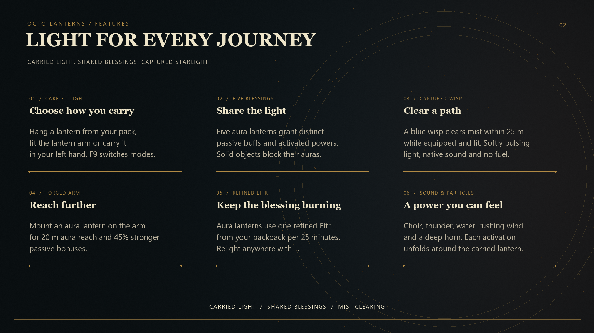
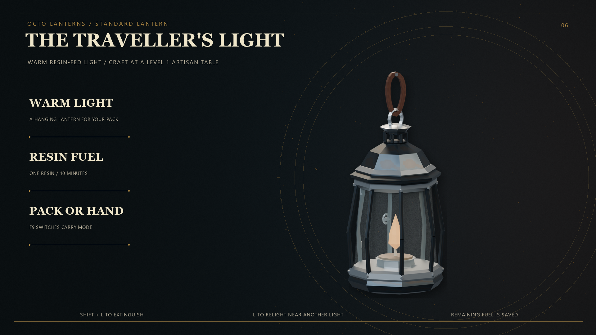
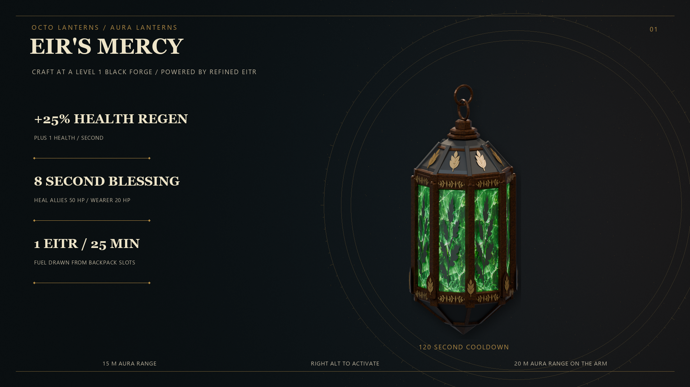
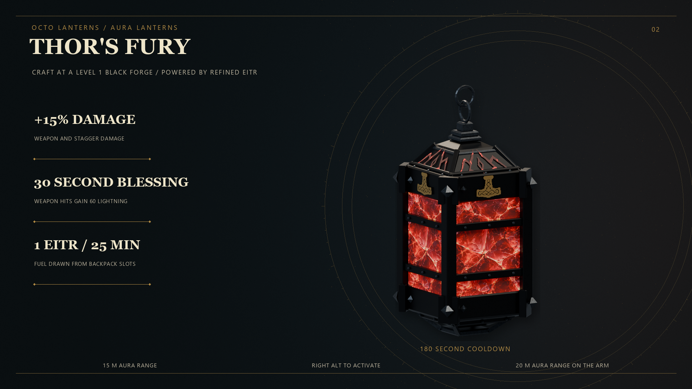
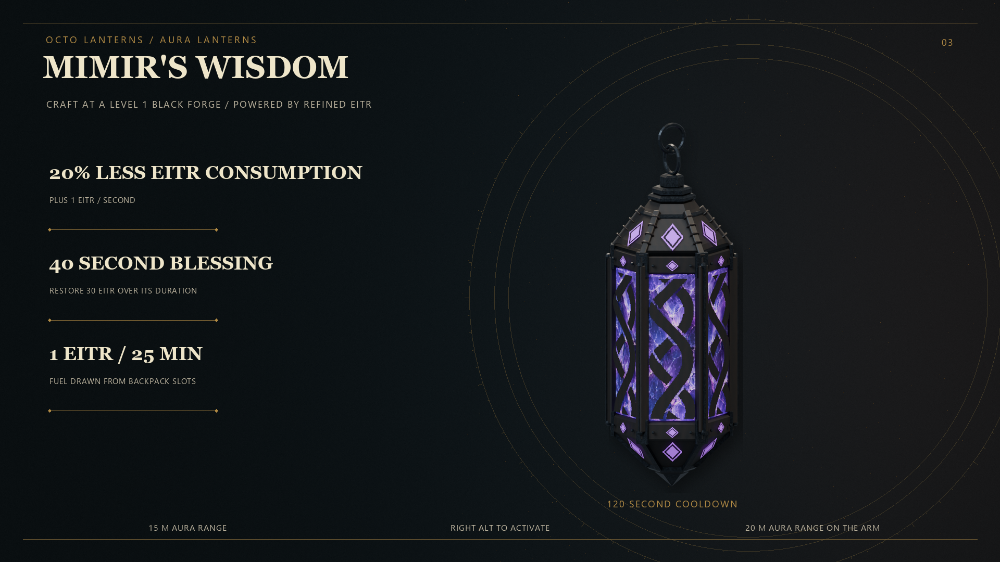
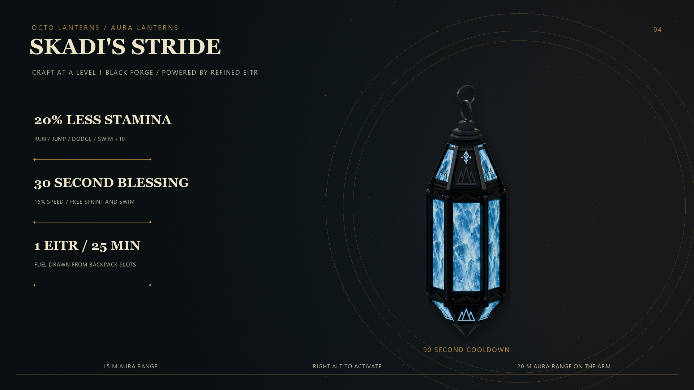
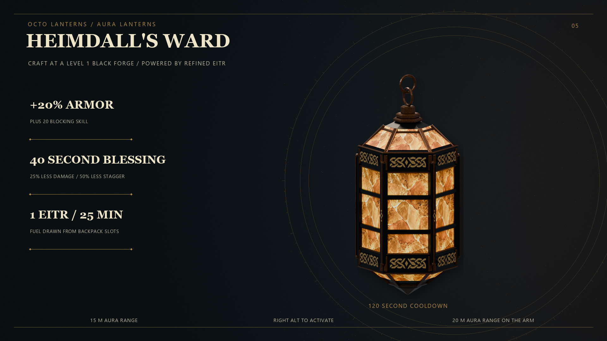
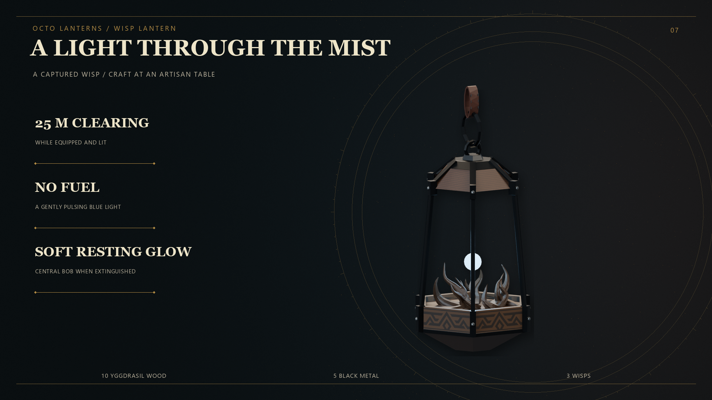
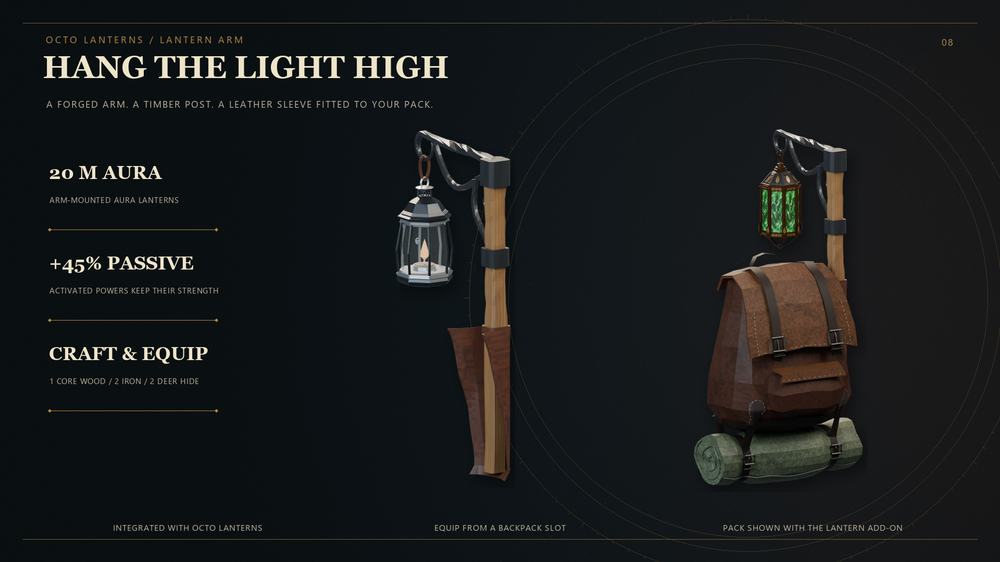

# OctoPack Lantern

Seven craftable lanterns and an integrated lantern arm for OctoPack, with hand carrying, swinging light, a mist-clearing wisp, and five aura abilities.

## Download

[Download Lantern 1.2.2](https://github.com/octerockman/OctoPack-Lantern/releases/tag/v1.2.2).

## Requirements

- Valheim with BepInEx installed.
- **[Bascinet's OctoPack 1.7.2 or newer](https://github.com/octerockman/OctoPack/releases/latest).**

OctoPack is a required dependency of this build. A compatible mod manager installs it automatically. For manual installs, install OctoPack separately before Lantern.

## Features

- Standard resin lantern plus Eir's Mercy, Thor's Fury, Mimir's Wisdom, Skadi's Stride, Heimdall's Ward, and the Wisp Lantern.
- Integrated craftable lantern arm for over-the-shoulder carrying.
- Backpack mounting and left-hand carrying, with configurable swing, light, glass, shadows, and size.
- Five aura abilities with dedicated sounds, particle effects, active-time displays, and a yellow outlined cooldown timer.
- Fuel-free Wisp Lantern with blue pulsing light, a nearby orbiting wisp, a softly glowing resting state, and 25 m mist clearing when lit.
- Saved lantern and arm selection on portable backpacks. Dropped and displayed packs retain supported light, mist, fuel, and passive aura behavior.
- Fitted saved ground poses and contacts so the arm and lantern move with a dropped pack.

## Installation

Install a published Thunderstore package with a compatible mod manager to resolve its dependencies automatically. For the GitHub download, follow the manual instructions below.

For manual installation, close Valheim and copy this ZIP's `plugins` folder into your existing `BepInEx` folder. The resulting file is:

`BepInEx/plugins/OctoPack_addon_Lantern/OctoPack_addon_Lantern.dll`

Keep one copy of the DLL and retain your existing configuration when updating.

### Upgrading from the separate Lantern Arm add-on

The arm is now integrated into Lantern. Remove the old `OctoPack_addon_LanternArm.dll` from your installed plugins; do not install it alongside this package. Its configuration can be migrated into the integrated arm settings.

## Default controls

| Action | Control |
| --- | --- |
| Switch between the backpack/arm mount and left hand | F9 |
| Relight | L |
| Extinguish | Either Shift + L |
| Activate the selected aura ability | Right Alt |

Equip lanterns and the arm from backpack slots. An equipped arm takes precedence over the bedroll-strap mount. Hand carrying follows the current weapon and shield restrictions.

## Crafting and fuel

| Lantern | Crafting and fuel |
| --- | --- |
| Standard | Artisan table; consumes one backpack Resin per 10 minutes. Relighting requires another active light nearby. |
| Five aura lanterns | Level 1 Black Forge; consumes one backpack Refined Eitr per 25 minutes. Can be relit without another light nearby. |
| Wisp | Artisan table; 10 Yggdrasil Wood, 5 Black Metal, and 3 Wisps. No fuel. |

See in-game recipes for each aura lantern's ingredients.

Current activated ability durations are Eir **8 seconds**, Thor **30 seconds**, Mimir **40 seconds**, Skadi **30 seconds**, and Heimdall **40 seconds**.

## Lanterns and arm

## Configuration

`BepInEx/config/OctoPack_addon_Lantern.cfg` is generated on first launch. Integrated arm options share this file in its arm sections.

Current defaults include lantern physics drag **0.6**, general cast-light brightness **0.7**, and Wisp Lantern cast-light brightness **0.37**. Existing custom settings are kept.

This ZIP contains the plugin and embedded defaults, without a replacement user config.

## Multiplayer and dedicated servers

Install Lantern on clients that should see and use its lanterns or receive its aura effects. Those clients also need OctoPack.

Dedicated servers need **OctoPack 1.7.2 or newer**, using the same core DLL as clients. The Lantern DLL is a client add-on and is not required on the headless server.

Dropped-pack lights and fuel are maintained by an owning, loaded Lantern client. This release does not provide continuous offline or headless lantern fuel simulation.

## Compatibility

This package already contains the arm. It does not include the retired belt hook or its position editor. F9 switches hand carrying.

Do not install duplicate Lantern DLLs or the legacy `Octodad.BackpackLantern` plugin. Camping is a separate optional add-on.

## Credits

OctoDad / Bascinet.
